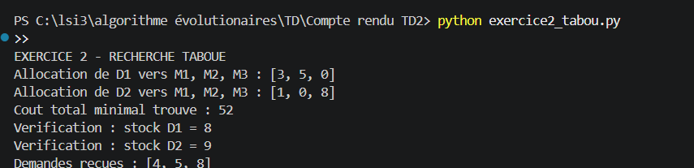
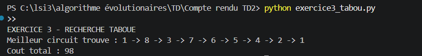
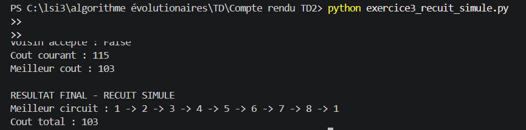

# Travaux Dirigés n°2 — Recherche Taboue et Recuit Simulé

## Description du projet

Ce projet consiste à résoudre des problèmes d'optimisation à l'aide de méthodes de recherche locale en Python.

Les exercices réalisés sont :

- **Exercice 2 :** résolution d'un problème d'allocation par la recherche taboue.
- **Exercice 3 :** résolution du problème du voyageur de commerce par deux méthodes :
  - Recherche taboue.
  - Recuit simulé.

## Technologies utilisées

- Python 3
- Visual Studio Code

## Organisation des fichiers

- `exercice2_tabou.py` : implémentation de la recherche taboue pour l'exercice 2.
- `exercice3_tabou.py` : implémentation de la recherche taboue pour l'exercice 3.
- `exercice3_recuit_simule.py` : implémentation du recuit simulé pour l'exercice 3.

## Exécution des programmes

Ouvrir un terminal dans le dossier du projet et exécuter les commandes suivantes :

```bash
python exercice2_tabou.py
python exercice3_tabou.py
python exercice3_recuit_simule.py
```

## Résultats obtenus

### Exercice 2 — Recherche taboue
Après l'exécution de l'algorithme de recherche taboue, nous obtenons l'allocation suivante. Le coût total obtenu est égal à 52. Les stocks disponibles et les demandes sont respectés.

### Exercice 3 — Recherche taboue
L'algorithme de recherche taboue permet d'obtenir un circuit de coût total égal à 98.



### Exercice 3 — Recuit simulé
Après cinq itérations, le meilleur circuit obtenu a un coût total de 103.



## Remarque

Les résultats dépendent de l'initialisation et des paramètres des algorithmes. Ils correspondent aux meilleures solutions trouvées lors des exécutions réalisées et ne garantissent pas nécessairement l'optimum global.